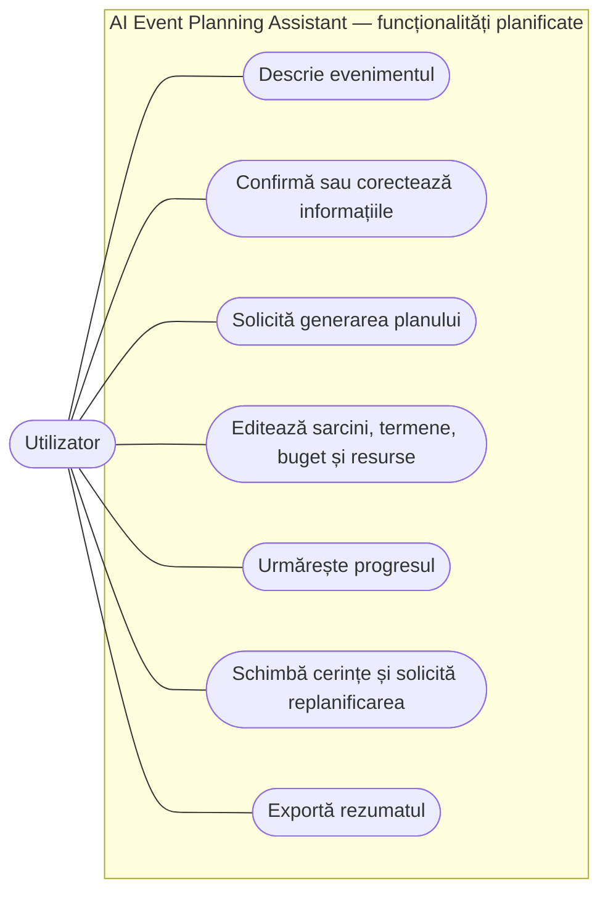
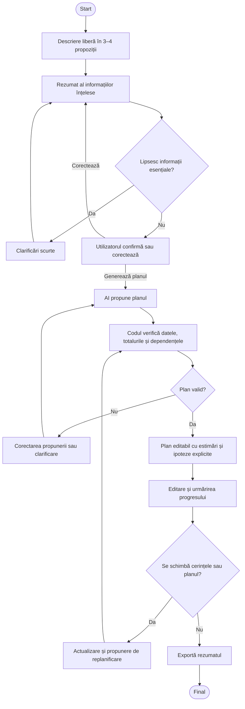

# AI-Powered Event Planning Assistant

Proiect de aplicație care va transforma o descriere liberă a unui eveniment într-un plan editabil cu sarcini, dependențe, termene, buget și resurse necesare. Un model AI existent va propune planul, iar codul aplicației va verifica datele calendaristice, totalurile și dependențele.

Lucrare de licență, Automatică și Calculatoare, Universitatea Politehnica Timișoara.

**Stadiu:** proiectare. Funcționalitățile, arhitectura și pașii de mai jos sunt planificați, nu reprezintă funcționalități deja implementate. Prima versiune va viza nunți și aniversări.

## Cuprins

1. [Problema](#1-problema)
2. [Documentare](#2-documentare)
3. [Proiectare](#3-proiectare)
4. [Implementare](#4-implementare)
5. [Testare și evaluare](#5-testare-și-evaluare)
6. [Concluzii](#6-concluzii)

---

## 1. Problema

### Ce problemă va rezolva aplicația?

Organizarea unei nunți sau aniversări presupune sarcini legate între ele, resurse necesare, un buget limitat și termene care se pot schimba. O listă simplă de sarcini nu descrie toate aceste relații, iar un plan oferit ca text liber este dificil de urmărit și actualizat.

Aplicația va porni de la o descriere în limbaj natural, de aproximativ 3–4 propoziții, fără un chestionar obligatoriu la început. Va prezenta informațiile înțelese pentru confirmare și va solicita clarificări scurte doar dacă lipsesc informații esențiale. După confirmare, va genera un plan editabil și va permite urmărirea progresului și replanificarea la schimbarea cerințelor.

### Utilizatori țintă

- persoane care își organizează nunta sau o aniversare;
- organizatori mici care pregătesc astfel de evenimente;
- persoane care au nevoie de ajutor pentru structurarea și actualizarea planului.

### Scenariu de demonstrație planificat

Utilizatorul va descrie în 3–4 propoziții o aniversare pentru 60 de persoane, cu buget de 5.000 EUR, precizând data și locul. Aplicația va afișa un rezumat pentru confirmare și va cere scurt eventualele informații esențiale lipsă. După corectare și apăsarea butonului „Generează planul”, va propune sarcini cu dependențe, termene, buget și resurse necesare. Dacă numărul de invitați va crește la 80, aplicația va identifica elementele afectate și va propune ajustări ale planului.

### În afara scopului inițial

Aplicația nu va rezerva și nu va plăti furnizori și nu va presupune antrenarea unui model AI propriu. Costurile fără o sursă verificabilă vor fi marcate drept estimări, iar ipotezele folosite vor fi afișate explicit.

---

## 2. Documentare

### Aplicații de analizat

| Aplicație | Aspecte de analizat pentru proiect |
|---|---|
| [Trello](https://trello.com), [Asana](https://asana.com) | Organizarea sarcinilor, termenele și urmărirea progresului |
| [Notion](https://www.notion.so) | Șabloanele și organizarea informațiilor despre eveniment |
| [Zola](https://www.zola.com), [The Knot](https://www.theknot.com) | Planificarea nunților, listele de sarcini și bugetul |
| Chatbot-uri generale | Generarea unui plan din descriere liberă și limitele unui rezultat în text liber |

### Lucrări relevante

- [TravelPlanner (2024)](https://arxiv.org/abs/2402.01622): reper pentru studierea planificării cu constrângeri de către modele de limbaj.
- [On the Planning Abilities of LLMs (2023)](https://arxiv.org/abs/2302.06706): reper pentru studierea capacităților și limitelor de planificare ale modelelor de limbaj.

Integrarea AI va fi documentată după alegerea furnizorului. Se va urmări obținerea unui răspuns structurat, care să poată fi validat și transformat în obiectele aplicației.

### Direcția propusă pentru proiect

Proiectul va combina planificarea asistată de AI cu verificări în cod. Planul va conține sarcini structurate, dependențe, termene, buget și resurse, va putea fi editat și va putea fi actualizat când se schimbă cerințele. Estimările și ipotezele vor fi vizibile pentru utilizator.

---

## 3. Proiectare

### Funcționalități principale planificate (MVP)

- [ ] descriere liberă a unei nunți sau aniversări în aproximativ 3–4 propoziții;
- [ ] rezumat al informațiilor înțelese, cu posibilitatea de corectare înainte de generare;
- [ ] clarificări scurte doar pentru informațiile esențiale lipsă;
- [ ] generare la apăsarea butonului „Generează planul”;
- [ ] plan editabil cu sarcini corelate prin dependențe, termene, buget și resurse necesare;
- [ ] urmărirea progresului prin starea sarcinilor și termenele apropiate;
- [ ] urmărirea bugetului planificat și a cheltuielilor reale;
- [ ] verificarea în cod a datelor calendaristice, totalurilor și dependențelor;
- [ ] afișarea explicită a estimărilor și ipotezelor;
- [ ] replanificare la schimbarea datei, numărului de invitați, bugetului sau altor cerințe;
- [ ] rezumat exportabil al planului.

### Arhitectura propusă

```text
[ Interfață: HTML, CSS, Thymeleaf, Bootstrap ]
[ JavaScript introdus treptat pentru interacțiuni ]
                         |
                         v
[ Backend Java + Spring Boot ]
[ Controlere, servicii și obiecte de domeniu ]
             |                          |
             v                          v
[ Spring Data JPA / Hibernate ]   [ Integrare model AI prin API ]
             |                    [ Furnizor ales ulterior ]
             v
[ PostgreSQL ]
```

- **Interfața** va afișa descrierea, confirmarea, clarificările, planul și progresul, folosind pagini generate cu Thymeleaf.
- **Backendul** va avea o organizare orientată pe obiecte, cu responsabilități separate pentru controlere, servicii, obiecte de domeniu și accesul la date.
- **Accesul la date** se va realiza prin ORM, folosind Spring Data JPA / Hibernate și PostgreSQL pentru persistență.
- **Integrarea AI** va apela din backend un model existent. Furnizorul va fi ales ulterior.
- **Logica de verificare** din backend va controla datele calendaristice, totalurile și dependențele înainte de prezentarea planului și după modificările utilizatorului. Problemele identificate vor conduce la corectarea propunerii sau la o clarificare, după caz.

### Tehnologii propuse

| Componentă | Tehnologie / abordare |
|---|---|
| Backend | Java + Spring Boot, organizare orientată pe obiecte |
| Bază de date | PostgreSQL |
| Acces la date prin ORM | Spring Data JPA / Hibernate |
| Interfață | HTML, CSS și Thymeleaf |
| Stilizare | Bootstrap |
| Interacțiuni în interfață | JavaScript introdus treptat |
| AI | Model existent, accesat prin API din backend; furnizor ales ulterior |
| Verificări ale planului | Logică Java pentru date calendaristice, totaluri și dependențe |

### Cazuri de utilizare planificate



### Fluxul utilizatorului planificat

1. Utilizatorul va descrie evenimentul în aproximativ 3–4 propoziții, fără completarea unui chestionar obligatoriu.
2. Aplicația va afișa un rezumat al informațiilor înțelese de AI. Dacă vor lipsi informații esențiale, va solicita clarificări scurte.
3. Utilizatorul va putea corecta informațiile și răspunde la clarificări, apoi va apăsa **„Generează planul”**.
4. AI-ul va propune planul, iar codul aplicației va verifica datele calendaristice, totalurile și dependențele. Estimările și ipotezele vor fi indicate clar.
5. Utilizatorul va putea edita planul și urmări progresul. La schimbarea cerințelor, aplicația va propune ajustări și va verifica din nou planul.

Exemplu de confirmare scurtă pe care aplicația o va afișa după descriere și înainte de generarea planului:

> Am înțeles: nuntă, august 2027, 120 de invitați, Brașov, buget 20.000 EUR.
>
> Locație în aer liber, muzică live.
>
> **Ce flexibilitate accepți pentru buget?**

Întrebarea despre flexibilitatea bugetului va apărea doar dacă această informație va fi necesară și nu va fi deja precizată. Dacă pentru calculul termenelor va fi necesară ziua exactă a evenimentului, aplicația va cere și această clarificare. Utilizatorul va putea corecta rezumatul înainte de a apăsa **„Generează planul”**.



### Principii de proiectare

- **Intrare simplă:** descriere liberă, urmată de confirmare și clarificări doar când sunt necesare.
- **Plan structurat:** sarcinile vor avea dependențe, termene, buget și resurse necesare.
- **Verificare în cod:** regulile pentru date calendaristice, totaluri și dependențe vor fi verificate în backend și după editarea planului.
- **Transparență:** estimările și ipotezele vor fi diferențiate de informațiile confirmate de utilizator.
- **Replanificare:** modificările cerințelor vor conduce la identificarea elementelor afectate și la propunerea unor ajustări.

### Extensie planificată: invitații

Generarea textelor și a modelelor vizuale pentru invitații va fi abordată după ce fluxul principal de descriere, confirmare, generare, editare și replanificare va funcționa. Această extensie nu face parte din MVP.

---

## 4. Implementare

Implementarea este planificată în următoarele etape:

1. Structurarea aplicației Java + Spring Boot și a obiectelor de domeniu; configurarea PostgreSQL și a accesului prin Spring Data JPA / Hibernate.
2. Construirea interfeței HTML, CSS și Thymeleaf, cu Bootstrap și JavaScript introdus treptat; editarea evenimentelor, sarcinilor, bugetului și resurselor, plus urmărirea progresului.
3. Implementarea verificărilor pentru date calendaristice, totaluri și dependențe.
4. Alegerea furnizorului AI și integrarea API-ului din backend, cu descriere liberă, rezumat de confirmare și clarificări scurte înainte de generare.
5. Generarea planului structurat, validarea propunerilor și afișarea estimărilor și ipotezelor.
6. Replanificarea la schimbarea cerințelor și exportul rezumatului.
7. După funcționarea fluxului principal, explorarea extensiei pentru texte și modele vizuale de invitații.

---

## 5. Testare și evaluare

Vor fi planificate:

- **Teste software:** verificări unitare pentru date calendaristice, totaluri și dependențe și teste de integrare pentru persistență și fluxul complet, inclusiv editare și replanificare.
- **Evaluarea interacțiunii:** descrieri complete și incomplete, corectarea rezumatului și clarificări cerute numai când lipsesc informații esențiale.
- **Evaluare AI:** un set fix de descrieri de nunți și aniversări, pe care se vor măsura:
  - completitudinea planului, inclusiv resursele necesare;
  - respectarea constrângerilor și coerența dependențelor;
  - afișarea explicită a estimărilor și ipotezelor;
  - consistența după editare și replanificare;
  - latența și costul per plan;
  - utilitatea, într-un studiu mic cu utilizatori.

*Rezultatele vor fi completate după implementare și rularea experimentelor.*

---

## 6. Concluzii

### Rezultate

*De completat după implementare și evaluare.*

### Limite anticipate

Estimările de cost vor depinde de informațiile disponibile și nu vor reprezenta oferte de la furnizori. Alte limite anticipate sunt dependența de un API extern și dimensiunea setului de evaluare. Prima versiune va fi limitată la nunți și aniversări.

### Direcții viitoare

- generarea textelor și a modelelor vizuale pentru invitații, după funcționarea fluxului principal;
- compararea furnizorilor de servicii pentru evenimente;
- integrarea cu calendarul;
- colaborarea între mai mulți utilizatori.
