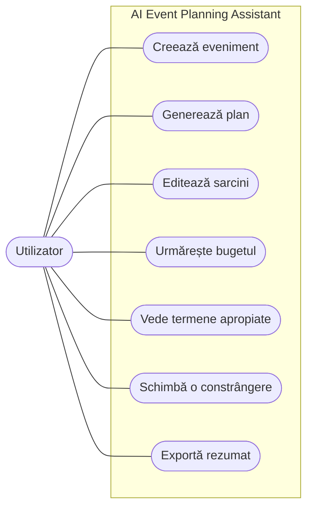
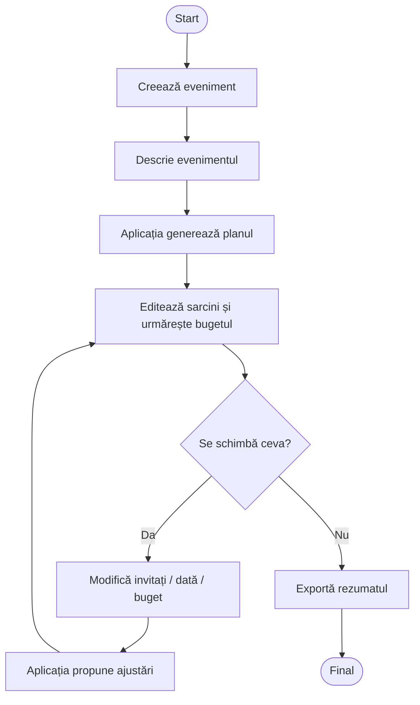
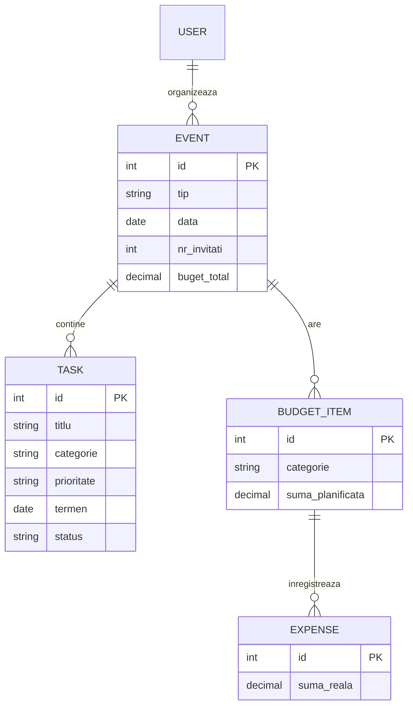

# AI-Powered Event Planning Assistant

Aplicație care transformă o descriere în limbaj natural a unui eveniment într-un plan editabil cu sarcini, termene și buget, folosind un LLM pentru planificare și logică clasică pentru date, costuri și dependențe.

Lucrare de licență, Automatică și Calculatoare, Universitatea Politehnica Timișoara.

## Cuprins

1. [Problema](#1-problema)
2. [Documentare](#2-documentare)
3. [Proiectare](#3-proiectare)
4. [Implementare](#4-implementare)
5. [Testare și evaluare](#5-testare-și-evaluare)
6. [Concluzii](#6-concluzii)

---

## 1. Problema

### Ce problemă rezolvă aplicația?

Organizarea unui eveniment (nuntă, zi de naștere, conferință) înseamnă multe sarcini legate între ele, un buget limitat și termene care se schimbă. Uneltele obișnuite o rezolvă slab:

- listele de sarcini nu știu ce trebuie făcut pentru un anumit tip de eveniment;
- chatbot-urile produc planuri ca text liber, care nu pot fi bifate, urmărite sau recalculate;
- când se schimbă ceva (invitați, dată, buget), planul se reface manual.

Aplicația primește o descriere a evenimentului, generează un plan structurat (sarcini, termene, buget) și, când se schimbă o constrângere, propune doar ajustările necesare.

### Utilizatori țintă

- persoane care organizează un eveniment personal (nuntă, zi de naștere);
- organizatori mici și voluntari (evenimente studențești, conferințe);
- oricine nu știe de unde să înceapă sau își schimbă des planurile.

### Scenariu de demonstrație

Utilizatorul creează o zi de naștere pentru 60 de persoane, cu buget de 5.000 EUR. Aplicația generează sarcinile, cronologia și bugetul. Apoi utilizatorul schimbă numărul de invitați la 80, iar aplicația arată ce sarcini sunt afectate și propune ajustările necesare.

### Ce nu fac

Nu rezerv și nu plătesc furnizori, nu generez prețuri precise fără o sursă și nu antrenez modele proprii.

---

## 2. Documentare

### Aplicații existente

| Aplicație | Ce face | Ce lipsește |
|---|---|---|
| [Trello](https://trello.com), [Asana](https://asana.com) | Kanban, termene, colaborare | Nu generează planul și nu știu tipul evenimentului |
| [Notion](https://www.notion.so) | Șabloane flexibile, asistent AI | Structura se construiește manual; fără verificarea bugetului și a termenelor |
| [Zola](https://www.zola.com), [The Knot](https://www.theknot.com) | Checklist și buget pentru nunți | Doar nunți, checklist generic |
| Chatbot general (Claude, ChatGPT) | Plan rapid din descriere liberă | Text lung, fără urmărire de sarcini sau buget |

### Lucrări și instrumente relevante

- [TravelPlanner (2024)](https://arxiv.org/abs/2402.01622): planificare cu constrângeri (buget, date) pentru LLM-uri.
- [On the Planning Abilities of LLMs (2023)](https://arxiv.org/abs/2302.06706): LLM-urile singure planifică slab, deci planul trebuie verificat.
- [Claude Structured Outputs](https://platform.claude.com/docs/en/build-with-claude/structured-outputs) și [Pydantic](https://docs.pydantic.dev): ieșiri JSON validate.

### Cu ce este diferit acest proiect?

Combină planificarea generată de LLM cu verificare deterministă: planul este format din sarcini structurate, iar bugetul, datele și dependențele sunt verificate în cod. Mai are re-planificare parțială și este disponibil online.

---

## 3. Proiectare

### Funcționalități principale (MVP)

- [ ] creare eveniment (dată, invitați, buget, preferințe)
- [ ] plan generat de AI: categorii, sarcini, cronologie
- [ ] kanban / checklist editabil
- [ ] buget planificat vs. real
- [ ] dashboard cu termene apropiate
- [ ] re-planificare după schimbarea unei constrângeri
- [ ] rezumat exportabil
- [ ] deployment online

### Arhitectura

```
[ Client: dashboard, kanban, buget, asistent ]
                  │
                  ▼
[ Backend / API (FastAPI) ]
                  │
   ┌──────────────┼──────────────────┐
   ▼              ▼                  ▼
[ Baza de date ] [ Strat LLM ]    [ Rules engine ]
  evenimente      brief → plan      date, buget,
  sarcini         editare           dependențe
  cheltuieli
```

- **Client:** afișează planul și trimite cererile utilizatorului.
- **Backend și baza de date:** păstrează evenimentele, sarcinile și cheltuielile.
- **Strat LLM:** transformă descrierea în sarcini și categorii de buget.
- **Rules engine:** verifică planul; dacă are erori, modelul este rugat să-l corecteze.

### Tehnologii (de confirmat)

| Strat | Tehnologie |
|---|---|
| Frontend | React + TypeScript |
| Backend | Python + FastAPI |
| Bază de date | PostgreSQL |
| AI | Claude API (SDK-ul Python Anthropic) |
| Validare | Pydantic |
| Teste | pytest |
| Deployment | Docker pe un server în cloud |

### Diagrama cazurilor de utilizare



### Fluxul utilizatorului



### Modelul de date



### Idei de design

- **Plan structurat:** modelul returnează sarcini cu termen, categorie, prioritate și dependențe, nu text liber.
- **Verificare în cod:** totalurile de buget, datele și dependențele nu sunt lăsate pe seama modelului.
- **Re-planificare parțială:** la o schimbare se recalculează doar ce este afectat.

---

## 4. Implementare

*De completat pe parcurs.* Pașii planificați:

1. aplicația fără AI: evenimente, sarcini, buget, dashboard;
2. integrarea LLM-ului cu ieșiri structurate și validare;
3. repair loop când planul încalcă data sau bugetul;
4. re-planificare și export;
5. deployment online.

---

## 5. Testare și evaluare

- **Teste software:** unitare pentru logica de buget, termene și dependențe; de integrare pentru fluxul complet (creare, generare, editare, re-planificare).
- **Evaluare AI:** set fix de descrieri de evenimente (briefuri sintetice), pe care măsor:
  - completitudinea planului (cerințele obligatorii sunt acoperite?);
  - respectarea constrângerilor (date, invitați, buget);
  - consistența după re-planificare;
  - latența și costul per plan;
  - utilitatea, într-un studiu mic cu utilizatori.

*Rezultatele se completează după rularea experimentelor.*

---

## 6. Concluzii

### Ce funcționează

*De completat la final.*

### Limite

*De completat la final.* Limite așteptate: costuri nerealiste dacă nu sunt introduse prețuri, dependența de un API extern, set mic de teste.

### Direcții viitoare

- comparare de furnizori;
- texte pentru invitații;
- integrare cu calendarul;
- colaborare între mai mulți utilizatori.
