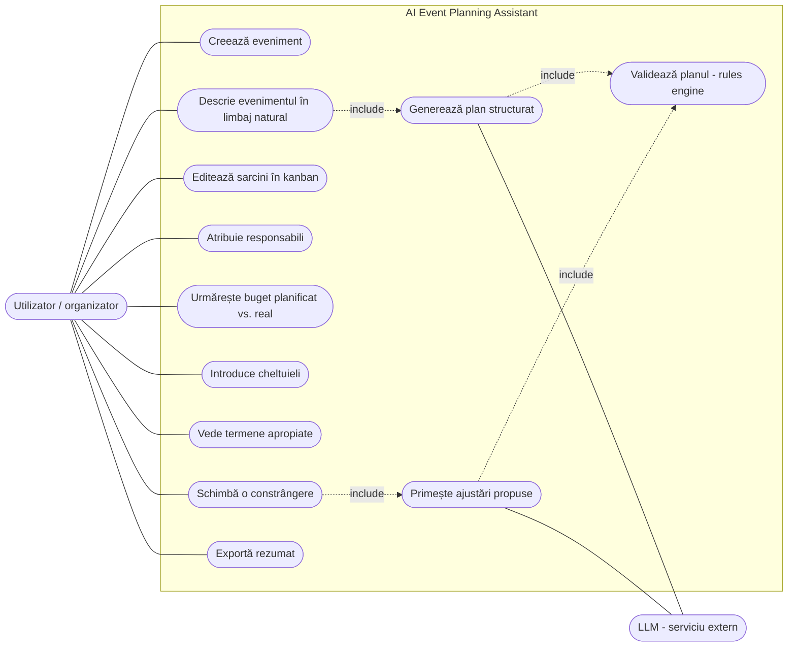
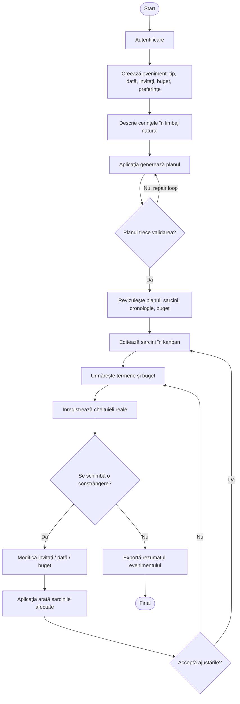
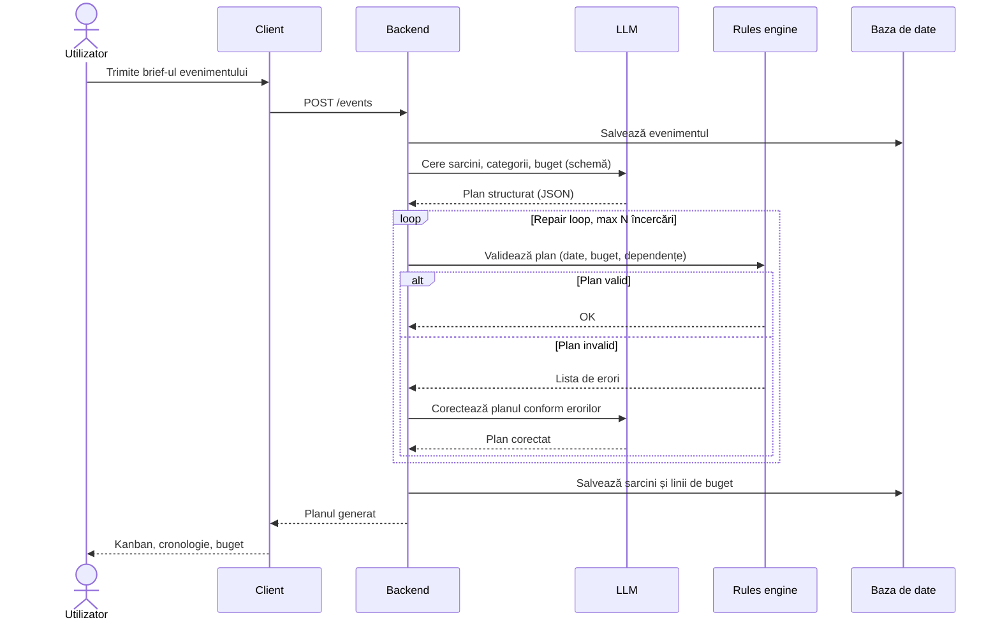
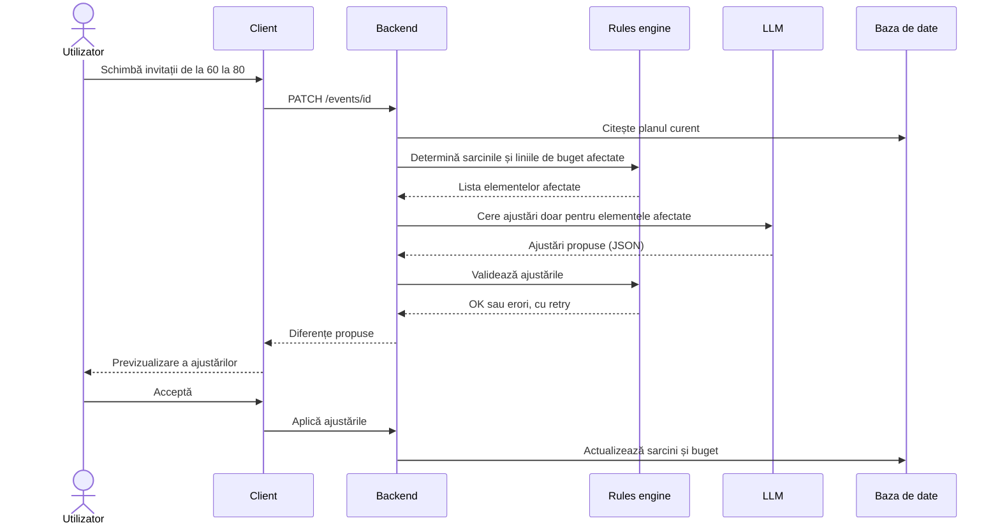
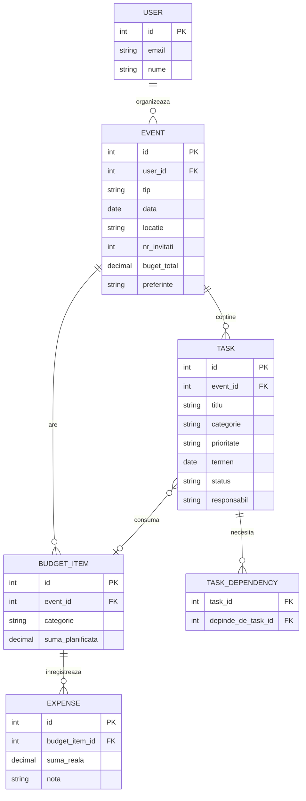
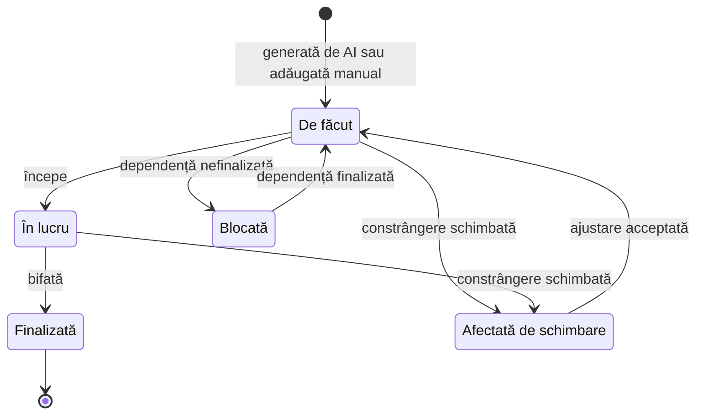

# AI-Powered Event Planning Assistant

An end-to-end event-management application that turns a natural-language event brief into an editable plan with structured tasks, timeline and budget, using an LLM for planning and deterministic application logic for dates, costs and dependencies.

Lucrare de licență, Automatică și Calculatoare, Universitatea Politehnica Timișoara.

---

## Ideea pe scurt

Utilizatorul descrie evenimentul în limbaj natural (tip, dată, locație, număr de invitați, buget, preferințe). Aplicația generează un **plan structurat**: categorii, sarcini cu termene și dependențe, cronologie și structură de buget. Planul se editează într-un kanban, iar costurile reale se compară cu cele planificate. Când se schimbă o constrângere (de exemplu numărul de invitați), asistentul găsește sarcinile afectate și propune **doar ajustările necesare**.

**AI-ul folosit:** un LLM prin API (Claude / Anthropic, de confirmat), pentru interpretarea briefului, generarea sarcinilor și editarea în limbaj natural. Nu antrenez niciun model. Bugetul, datele și dependențele sunt calculate și verificate **în cod**, nu în prompt.

## Cuprins

1. [Problema](#1-problema)
2. [Documentare și state of the art](#2-documentare-și-state-of-the-art)
3. [Proiectare](#3-proiectare)
4. [Implementare](#4-implementare)
5. [Testare și evaluare](#5-testare-și-evaluare)
6. [Concluzii](#6-concluzii)

---

## 1. Problema

### Ce problemă rezolvă aplicația?

Organizarea unui eveniment înseamnă zeci de sarcini legate între ele, un buget limitat și termene care se schimbă. Uneltele obișnuite o rezolvă slab:

- listele de sarcini și tabelele (Trello, Excel) nu știu nimic despre tipul evenimentului: utilizatorul trebuie să știe singur ce are de făcut și în ce ordine;
- chatbot-urile generale produc planuri ca text liber, lung și inconsistent, care nu poate fi bifat, urmărit sau recalculat;
- modelele pot inventa costuri precise fără nicio sursă;
- când se schimbă o constrângere (invitați, dată, buget), planul se reface manual, cu risc de sarcini uitate sau costuri nepotrivite.

Aplicația transformă brief-ul în sarcini și buget structurate, le verifică determinist și le menține consistente când situația se schimbă.

### Utilizatori țintă

| Utilizator | Ce are nevoie |
|---|---|
| **Persoane care organizează un eveniment personal** (nuntă, zi de naștere, botez) | Un plan complet pornind de la o descriere simplă, fără experiență anterioară. |
| **Organizatori mici și voluntari** (conferințe, evenimente studențești) | Sarcini cu responsabili și termene, control asupra bugetului. |
| **Cei care își schimbă des planurile** | Ajustări rapide când se schimbă numărul de invitați, data sau bugetul. |

### Scenariu de demonstrație

Utilizatorul creează o zi de naștere pentru **60 de persoane**, la o dată fixă, cu buget de **5.000 EUR**. Aplicația:

1. generează o cronologie, sarcini pe categorii și o structură de buget;
2. afișează sarcinile într-un kanban editabil și termenele apropiate într-un dashboard;
3. permite înregistrarea cheltuielilor reale față de cele planificate;
4. după ce utilizatorul schimbă numărul de invitați la **80**, identifică sarcinile și liniile de buget afectate;
5. propune doar ajustările necesare, pe care utilizatorul le acceptă sau le respinge.

### Obiective

1. Aplicație end-to-end cu persistență și dashboard-uri.
2. Plan generat de LLM ca date structurate (termen, categorie, prioritate, dependențe).
3. Verificare deterministă a datelor, bugetului și dependențelor, cu repair loop.
4. Re-planificare parțială după schimbarea unei constrângeri.
5. Evaluare repetabilă pe un set fix de briefuri sintetice.

### Ce nu fac

Nu construiesc o piață de furnizori, nu rezerv și nu plătesc automat furnizori, nu generez prețuri precise fără sursă externă (folosesc sume introduse de utilizator sau intervale), nu pun logica aplicației în prompt și nu antrenez modele proprii.

### Ce înseamnă „plan structurat”

Îi cer modelului să completeze entități cu câmpuri fixe, nu să scrie un eseu.

- **Răspuns liber (chatbot obișnuit):** „Ar trebui să rezervi locația cu vreo două luni înainte, apoi să vezi de tort...”. Programul nu poate extrage din el, în mod sigur, termenul sau dependențele unei sarcini.
- **Răspuns structurat (ce vreau eu):**

| id | titlu | categorie | prioritate | termen | depinde de |
|---|---|---|---|---|---|
| T1 | Rezervare locație | Locație | mare | 2026-03-01 | - |
| T2 | Confirmare meniu | Catering | mare | 2026-03-20 | T1 |

Coloanele formează **schema** (JSON, validată cu Pydantic). Astfel pot afișa planul în kanban, pot verifica automat constrângerile (termen înainte de data evenimentului, suma categoriilor sub buget, dependențe existente) și pot recalcula doar ce e afectat.

---

## 2. Documentare și state of the art

### 2.1 Aplicații existente

| Aplicație | Ce face bine | Ce lipsește pentru problema mea |
|---|---|---|
| [Trello](https://trello.com), [Asana](https://asana.com) | Kanban, termene, dependențe, colaborare. | Nu știu tipul evenimentului și nu generează planul; buget limitat sau absent. |
| [Notion](https://www.notion.so) | Șabloane și baze de date flexibile, asistent AI. | Utilizatorul construiește structura singur; fără verificare deterministă a bugetului și termenelor. |
| [Zola](https://www.zola.com), [The Knot](https://www.theknot.com) | Checklist și buget pentru nunți. | Doar un tip de eveniment; checklist generic, nu adaptat unui brief liber. |
| Chatbot general (Claude.ai, ChatGPT) | Plan din descriere liberă, rapid. | Text lung, fără persistență, sarcini urmărite sau buget recalculat; poate inventa costuri. |

*Tabelul va fi completat după testarea aplicațiilor pe același scenariu (zi de naștere de 60 de persoane).*

### 2.2 LLM-uri și planificare

| Lucrare | Relevanță pentru proiect |
|---|---|
| [TravelPlanner (2024)](https://arxiv.org/abs/2402.01622) | Benchmark de planificare cu constrângeri (buget, date, preferințe). Model pentru verificarea conformității planurilor. |
| [On the Planning Abilities of LLMs (2023)](https://arxiv.org/abs/2302.06706) | Arată că LLM-urile singure planifică slab; justifică verificarea externă. |
| [Self-Refine (2023)](https://arxiv.org/abs/2303.17651) | Rafinare iterativă pe baza feedback-ului. Context pentru repair loop. |
| [Chain-of-Thought Prompting (2022)](https://arxiv.org/abs/2201.11903) | Context pentru descompunerea sarcinilor prin prompting. |

### 2.3 Instrumente pentru ieșiri structurate

- [Claude Structured Outputs](https://platform.claude.com/docs/en/build-with-claude/structured-outputs): JSON conform unei scheme.
- [Anthropic Python SDK](https://github.com/anthropics/anthropic-sdk-python): clientul folosit din backend.
- [Pydantic](https://docs.pydantic.dev): definirea și validarea schemelor (sarcină, categorie, linie de buget).

### 2.4 Cu ce este mai bun acest proiect?

Spre deosebire de uneltele de sarcini (care nu generează nimic) și de chatbot-urile pur LLM (text liber, costuri inventate), aplicația combină **planificarea generativă** cu **logică deterministă**:

1. din brief în limbaj natural obțin entități structurate, nu text;
2. bugetul, datele și dependențele sunt verificate în cod, cu repair loop când modelul greșește;
3. re-planificare parțială, cu afișarea sarcinilor afectate;
4. buget planificat vs. real și dashboard de termene într-un singur loc;
5. evaluare reproductibilă pe briefuri sintetice fixe;
6. aplicație deployată online.

---

## 3. Proiectare

### 3.1 Cerințe

**Funcționale (MVP):**
- [ ] creare eveniment cu dată, număr de invitați, buget și preferințe
- [ ] categorii, sarcini și cronologie generate de AI, ca date structurate
- [ ] kanban / checklist editabil, cu responsabili
- [ ] buget cu costuri planificate vs. reale
- [ ] dashboard cu termene apropiate / reminder-e
- [ ] re-planificare după schimbarea unei constrângeri
- [ ] rezumat de eveniment exportabil
- [ ] deployment la un URL public

**Extra (doar după MVP):** comparare de furnizori pe baza linkurilor introduse de utilizator, generare de texte pentru invitații, integrare cu calendarul, colaborare multi-utilizator.

**Nefuncționale:** cheile API doar pe server, logare de bază, ieșiri LLM mereu validate, aplicație utilizabilă fără cunoștințe tehnice.

### 3.2 Arhitectura sistemului

```
[ Client (dashboard, kanban, timeline, buget, asistent) ]
                  │
                  ▼
[ Backend / API (FastAPI) ]
                  │
   ┌──────────────┼───────────────────────────┐
   ▼              ▼                           ▼
[ Baza de date ] [ Strat LLM de planificare ] [ Rules engine ]
  ├── Evenimente   ├── Brief → sarcini          ├── Date și termene
  ├── Sarcini      ├── Milestone-uri, categorii ├── Totaluri de buget
  ├── Dependențe   └── Editare în limbaj        ├── Dependențe
  └── Cheltuieli       natural                  └── Câmpuri lipsă
                          │                           ▲
                          └──────── repair loop ──────┘
                  │
                  ▼
[ Notificări / Export (reminder-e, rezumat eveniment) ]
```

| Componentă | Responsabilitate |
|---|---|
| Client | Dashboard de eveniment, cronologie, sarcini, buget, asistent de planificare. |
| Backend / baza de date | Evenimente, sarcini, dependențe, cheltuieli, starea utilizatorului. |
| Strat LLM de planificare | Transformă brief-ul în sarcini, milestone-uri și categorii de buget. |
| Rules engine | Verifică datele, totalurile de buget, dependențele și câmpurile obligatorii lipsă. |
| Notificări / export | Reminder-e de termene și rezumate partajabile. |

### 3.3 Tehnologii (propuse, de confirmat)

| Strat | Tehnologie |
|---|---|
| Frontend | React + TypeScript (sau alt framework pe care îl pot livra fiabil) |
| Backend | Python + FastAPI |
| Bază de date | PostgreSQL |
| AI | LLM prin API (Claude, prin SDK-ul Python Anthropic) |
| Validare ieșiri structurate | Pydantic |
| Teste | pytest |
| Deployment | Docker + Docker Compose pe un server în cloud, GitHub Actions pentru testare și deploy |

### 3.4 Diagrama cazurilor de utilizare (use case)



### 3.5 Fluxul utilizatorului (user flow)



### 3.6 Mockup-uri UX (schițe)

*Schițele de mai jos sunt pentru orientare; mockup-urile finale se fac în Figma.*

**Dashboard eveniment**

```
┌──────────────────────────────────────────────────────────────┐
│  Ziua lui Andrei                      60 invitați │ 5.000 EUR │
│  Data: 14.06.2026                     [Re-planifică] [Export]│
├───────────────────────────┬──────────────────────────────────┤
│  Termene apropiate        │  Buget                           │
│  ● Rezervare locație  3 z │  Planificat   4.800 EUR          │
│  ● Confirmare meniu   9 z │  Cheltuit     1.350 EUR          │
│  ● Invitații         14 z │  [██████░░░░░░░░░░░░░] 28%       │
├───────────────────────────┴──────────────────────────────────┤
│  Progres sarcini:  8 / 24 finalizate                         │
│  [Kanban]  [Cronologie]  [Buget]  [Asistent]                 │
└──────────────────────────────────────────────────────────────┘
```

**Kanban**

```
┌─ De făcut ───────┐ ┌─ În lucru ───────┐ ┌─ Finalizat ──────┐
│ Confirmare meniu │ │ Rezervare locație│ │ Alegere dată     │
│ Catering │ mare  │ │ Locație │ mare   │ │ General │ mică   │
│ Termen 20.03     │ │ Termen 01.03     │ │ Termen 10.02     │
│ ▸ depinde de T1  │ │ Resp.: Ana       │ │ Resp.: Andrei    │
├──────────────────┤ ├──────────────────┤ ├──────────────────┤
│ Invitații        │ │                  │ │                  │
└──────────────────┘ └──────────────────┘ └──────────────────┘
```

**Re-planificare**

```
┌──────────────────────────────────────────────────────────────┐
│  Schimbare: invitați 60 → 80                                 │
│  Sarcini afectate (4):                                       │
│   ☑ Confirmare meniu    - cantitate +33%                     │
│   ☑ Rezervare locație   - capacitate minimă 80               │
│   ☐ Cumpărare tort      - fără modificări                    │
│  Buget afectat: Catering 1.800 → 2.400 EUR                   │
│  Total propus 5.600 EUR  ⚠ depășește bugetul cu 600 EUR      │
│              [Respinge]            [Aplică ajustările]       │
└──────────────────────────────────────────────────────────────┘
```

### 3.7 Diagrama de secvență: generarea planului



### 3.8 Diagrama de secvență: re-planificare



### 3.9 Modelul de date (ER)



### 3.10 Ciclul de viață al unei sarcini



### 3.11 Decizii de design (2 soluții tehnic-aplicate)

1. **Plan structurat și verificat:** modelul nu returnează text, ci obiecte de tip sarcină (termen, categorie, prioritate, dependențe). Rules engine-ul verifică fiecare plan; dacă încalcă data evenimentului sau structura bugetului, erorile se trimit înapoi modelului într-un repair loop cu număr maxim de încercări.
2. **Re-planificare parțială:** când se schimbă o constrângere, aplicația determină în cod ce este afectat și cere modelului doar ajustările pentru acele elemente. Se reduc costul și latența, iar restul planului nu se modifică inutil.

Alte decizii: planul trăiește în tabele, nu în text; câteva șabloane generice de eveniment, nu orice tip posibil; costurile vin din sume introduse de utilizator sau intervale; cheile API rămân doar pe server.

---

## 4. Implementare

*De completat pe parcurs, începând cu nucleul fără AI și apoi cu partea de AI. Mai jos este structura planificată.*

### 4.1 Fluxul principal (pipeline)

1. **Creare eveniment:** formular cu tip, dată, locație, invitați, buget, preferințe; verificarea câmpurilor obligatorii.
2. **Interpretare brief:** transformarea cerinței într-un context structurat pentru model.
3. **Generare plan:** LLM-ul produce categorii, sarcini, milestone-uri și structură de buget ca obiecte structurate.
4. **Validare schemă:** verificarea cu Pydantic a câmpurilor și tipurilor.
5. **Verificare cu rules engine:** termene înainte de data evenimentului, totaluri de buget, dependențe valide, fără cicluri.
6. **Repair loop:** erorile sunt trimise înapoi modelului până planul trece verificările sau se atinge limita de încercări.
7. **Editare și urmărire:** kanban, buget planificat vs. real, dashboard de termene.
8. **Re-planificare și export:** ajustări propuse doar pentru partea afectată, rezumat exportabil, reminder-e.

### 4.2 Structura repository-ului (planificată)

```
.
├── backend/
│   ├── app/
│   │   ├── api/            # rute FastAPI
│   │   ├── models/         # entități DB
│   │   ├── schemas/        # scheme Pydantic (sarcină, buget, plan)
│   │   ├── services/
│   │   │   ├── llm_planner.py   # apeluri LLM, prompturi
│   │   │   ├── rules_engine.py  # date, buget, dependențe
│   │   │   └── replanner.py     # re-planificare parțială
│   │   └── main.py
│   └── tests/
├── frontend/               # dashboard, kanban, buget, asistent
├── evaluation/             # briefuri sintetice, script de evaluare, rezultate
├── docs/                   # diagrame, mockup-uri
└── docker-compose.yml
```

### 4.3 Endpoint-uri principale (planificate)

| Metodă | Rută | Rol |
|---|---|---|
| POST | `/events` | Creează eveniment și generează planul |
| GET | `/events/{id}` | Evenimentul cu sarcini și buget |
| PATCH | `/tasks/{id}` | Editează o sarcină (status, responsabil, termen) |
| POST | `/events/{id}/expenses` | Înregistrează o cheltuială |
| POST | `/events/{id}/replan` | Propune ajustări după schimbarea unei constrângeri |
| GET | `/events/{id}/export` | Rezumatul evenimentului |

### 4.4 Garanții în jurul LLM-ului

- ieșiri mereu validate cu scheme Pydantic;
- repair loop cu număr maxim de încercări și mesaj clar dacă eșuează;
- logare a cererilor, tokenilor și erorilor pentru depanare;
- prompt fără prețuri inventate: costurile pornesc de la sume introduse de utilizator sau intervale.

---

## 5. Testare și evaluare

Evaluarea folosește un set fix de **briefuri sintetice** de evenimente de mărimi și tipuri diferite, cu cerințe obligatorii scrise manual. Nu este nevoie de set de antrenare.

### 5.1 Testare software

- **Teste unitare:** calcul de buget, verificare de termene, graful de dependențe, validarea schemelor.
- **Teste de integrare / end-to-end:** creare eveniment, generare plan, editare, schimbare de constrângere, re-planificare.

### 5.2 Metrici

| Metrică | Ce măsoară |
|---|---|
| **Completitudine** | Procentul de cerințe obligatorii din brief acoperite de plan |
| **Respectarea constrângerilor** | Procentul de planuri cu date, invitați și categorii de buget conforme |
| **Consistență după re-planificare** | Sarcini modificate inutil vs. necesar când se schimbă o constrângere majoră |
| **Latență și cost** | Timp per generare și per revizuire; tokeni per apel |
| **Utilizabilitate** | Claritatea și utilitatea planului într-un studiu mic cu utilizatori |

### 5.3 Experimente

| Experiment | Compară | Metrici |
|---|---|---|
| E1 | Fără repair loop vs. cu repair loop (propunere) | conformitate, nr. de încercări, latență, cost |
| E2 | Re-planificare parțială vs. regenerare completă (propunere) | sarcini modificate inutil, latență, cost |
| E3 | Plan din text liber vs. din ieșire structurată (propunere) | completitudine, conformitate |

### 5.4 Rezultate

*De completat după rularea experimentelor.*

---

## 6. Concluzii

### Ce funcționează

*De completat la final, pe baza metricilor măsurate.*

### Limite

*De completat la final. Limite anticipate:* costuri nerealiste dacă utilizatorul nu introduce prețuri, planuri incomplete pentru tipuri de evenimente neacoperite de șabloane, dependența de un API extern (disponibilitate, cost, confidențialitatea datelor), set mic de briefuri sintetice, studiu de utilizabilitate cu puțini participanți.

### Ce am învățat

*De completat la final.*

### Direcții viitoare

- comparare de furnizori pe baza linkurilor introduse de utilizator;
- generare de texte pentru invitații și comunicări;
- integrare cu calendarul pentru termenele majore;
- colaborare multi-utilizator cu atribuirea sarcinilor.

---

## Rulare locală

*De completat după implementare (variabile de mediu, `docker compose up`, rularea testelor și a scriptului de evaluare).*
